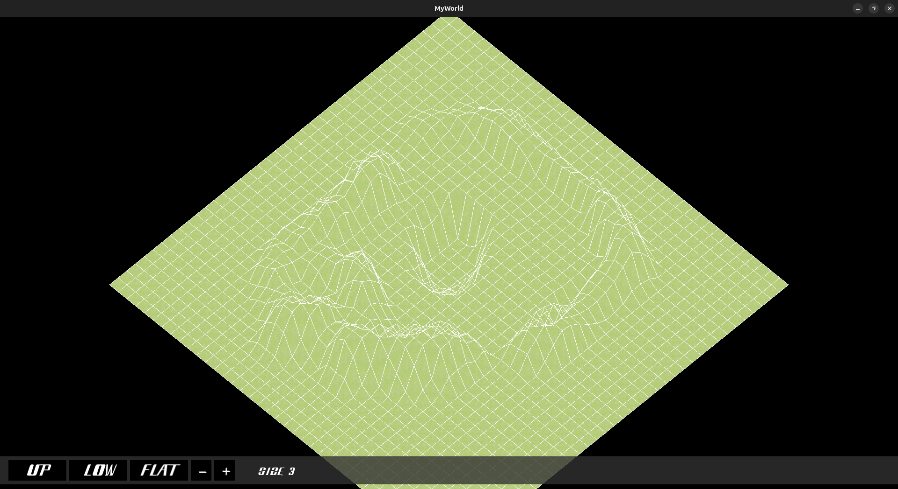

# MyWorld

MyWorld is a C application built with CSFML that lets you explore and edit a
3D terrain represented as an isometric map. Select a terrain tool, click on a
tile, and reshape the world with an adjustable brush.



## Features

- Isometric 40 x 40 terrain map
- Raise, lower, or flatten terrain tiles
- Adjustable brush size from 1 to 5
- Camera movement and zoom controls
- Toggleable grass textures
- Interactive main menu and in-game help screen
- Sound effects for menu interactions

## Requirements

You need the following tools and libraries installed:

- GCC
- GNU Make
- CSFML 2.x:
  - `libcsfml-graphics`
  - `libcsfml-window`
  - `libcsfml-system`
  - `libcsfml-audio`
- The standard C math library

On Debian or Ubuntu, the CSFML dependencies can be installed with:

```bash
sudo apt install build-essential libcsfml-dev
```

## Build

Run the following commands from the repository root:

```bash
make
```

The executable `my_world` is created in the repository root. To remove build
files and the executable:

```bash
make clean
make fclean
```

To rebuild the project from scratch:

```bash
make re
```

## Run

Start the application from the repository root so that the asset paths are
resolved correctly:

```bash
./my_world
```

Display the command-line help without opening the window:

```bash
./my_world -h
```

## Controls

### Menu

- **PLAY**: enter the terrain editor
- **QUIT**: close the application
- **ESC**: exit from the main menu

### Terrain editor

- **Left mouse button**: modify the selected tile
- **UP**: raise terrain
- **LOW**: lower terrain
- **FLAT**: flatten terrain
- **- / +**: decrease or increase the brush size
- **Arrow keys**: move the camera
- **Mouse wheel**: zoom in or out
- **T**: toggle textures
- **ESC**: open or close the help menu
- **Window close button**: exit the application

## Project structure

```text
.
├── assets/                 # Fonts, images, and sound effects
├── include/my_world.h      # Shared types, constants, and declarations
├── src/                    # Terrain, camera, events, rendering, and setup
├── src/user_interface/     # Menu and button implementation
├── Makefile                # Build and cleanup commands
└── my_world                # Generated executable after compilation
```

## Assets

The program expects its resources in the `assets/` directory. Keep the
following layout intact when running the executable:

```text
assets/
├── fonts/Bleach.ttf
├── images/background.png
├── images/button.png
├── images/base_button.png
├── images/grass.png
├── images/myWorld.png
├── images/up_arrow.png
└── sounds/click_sound.mp3
   sounds/select_sound.mp3
```
